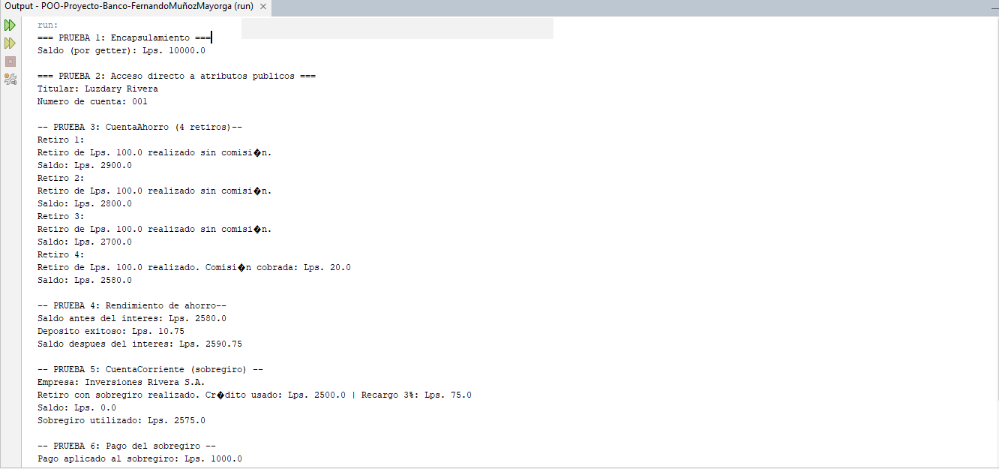
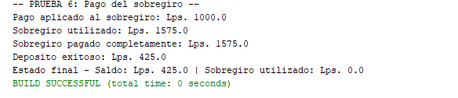

# POO-Proyecto-Banco-FernandoMunozMayorga

Simulador bancario en Java que aplica **encapsulamiento** y **herencia**.
Tarea 1 de Programación Orientada a Objetos.

## Datos del estudiante

- **Nombre completo:** Fernando Daniel Muñoz Mayorga
- **Cuenta:** 20252030418

## Descripción

El proyecto modela cuentas bancarias con tres clases:

| Archivo | Descripción |
| --- | --- |
| `CuentaBancaria.java` | Clase base. Saldo y contador de transacciones privados, con depósitos y retiros validados. |
| `CuentaAhorro.java` | Hereda de `CuentaBancaria`. Cobra comisión desde el 4.º retiro del mes y calcula interés mensual. |
| `CuentaCorriente.java` | Hereda de `CuentaBancaria`. Maneja un cupo de sobregiro con recargo del 3 % y pago de la deuda. |
| `Main.java` | Ejecuta las 6 pruebas obligatorias de la tarea. |

## Cómo compilar y ejecutar

### Desde la terminal

Con el JDK instalado (Java 17 o superior), en la carpeta que contiene los archivos `.java`:

```
javac *.java
java Main
```

### Desde NetBeans

1. Abrir el proyecto.
2. Presionar **F6** (Run Project) y elegir `Main` como clase principal si lo pide.

## Resultado de la ejecución



